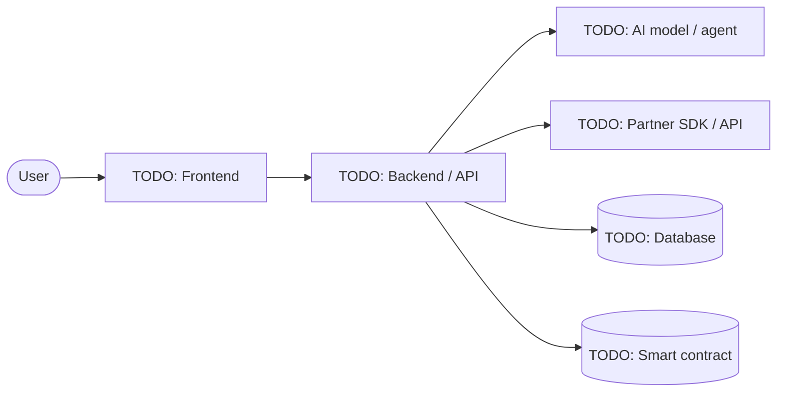

<!--
╔══════════════════════════════════════════════════════════════════════════╗
  TEAM1 TÜRKIYE HACKATHON TEMPLATE

  How to use it:
  1. Fork https://github.com/Team1-Turkiye/hackathon-template (fork, do not
     "Use this template": the jury links your project to the event through
     the fork). Rename the fork to your project's name if you like.
  2. Build your project in the fork, from scratch, during the event.
  3. Fill in every section of this README. Replace each "TODO" with real
     content. A section that does not apply gets "N/A" plus one line saying why.
  4. Before you submit: no "TODO" may be left in this file.
     Check with:  grep -n TODO README.md
  5. Delete this comment block and the participant notice below.

  The jury reads this README first and often only this README. If something
  is not written here, assume the jury will not know it.
  A filled-in example lives in docs/EXAMPLE_README.md.
╚══════════════════════════════════════════════════════════════════════════╝
-->

> [!IMPORTANT]
> **Participant?** Fork this repo, build your project in the fork and fill in this README. Full instructions are in [docs/PARTICIPANT_GUIDE.md](docs/PARTICIPANT_GUIDE.md), and a filled-in example is in [docs/EXAMPLE_README.md](docs/EXAMPLE_README.md). Delete this notice when you start.

# TODO: Project name

**TODO: One sentence that says what the project does and for whom.**

<!-- Optional: a logo or a hero screenshot. Put images in docs/assets/. -->
<!--  -->

---

## 1. At a glance

<!-- The jury reads this table first. Every row is required. Use full URLs. -->

| | |
|---|---|
| **Event** | TODO: event name and date, e.g. Agentic Hackathon, Ankara, 17 Oct 2026 |
| **Challenge / track** | TODO: the challenge or track you built for, as named in the event brief |
| **Short description** | TODO: 2 to 3 sentences. The problem, what you built, why it matters. |
| **Live demo** | TODO: URL of the deployed project (not localhost, not a tunnel that will close) |
| **Demo video** | TODO: 2 to 3 minute walkthrough (YouTube, Loom, Drive with public access) |
| **Pitch deck** | TODO: link to the deck you will present if you reach the final (public access) |
| **Tech stack** | TODO: one line, e.g. TypeScript, Next.js, Python, FastAPI, Postgres, Solidity |
| **Team** | TODO: names, linked to the [Team](#14-team) section |
| **Status** | TODO: Working end to end / Partially working / Prototype with mocked parts |

## 2. Event partner technologies

<!--
Many events have a partner (sponsor) whose products you are asked to use.
The organizers name the partner and its products in the event brief.
Add one row per partner product you used. Describe the feature that relies on
it, not just "we integrated X". If the event has no partner, write
"No partner at this event" and delete the table.
-->

**Partner(s) of this event:** TODO: e.g. OKX TR, Avalanche. Or "No partner at this event".

**Did you use the partner's products?** TODO: Yes / No. If no, one line on why.

| Partner | Product | What it does in your project | How central is it? |
|---|---|---|---|
| TODO | TODO: product, SDK or API name | TODO: the feature that relies on it | TODO: Core (the project does not work without it) / Supporting / Minor |

**Bonus tasks attempted:** TODO: list the event's bonus tasks you completed and what you did for each, or "None". Contract addresses go in section 3.

## 3. Onchain deployments

<!-- Only if your project deploys contracts or sends transactions. Otherwise: "N/A". -->

| Network | Contract / purpose | Address | Explorer link | Verified source |
|---|---|---|---|---|
| TODO: e.g. Avalanche Fuji | TODO | `0x…` | TODO | TODO: Yes / No |

## 4. Built at the event

<!--
Projects must be started from scratch at the event. Be honest here: anything
undeclared that turns out to predate the event can disqualify the project.
Using libraries, frameworks, starter kits and AI coding tools is fine; just
list them.
-->

- **First commit of the project:** TODO: date and time, with timezone
- **Pre-existing code you reused:** TODO: your own earlier code, boilerplates, starter templates, copied snippets. Or "None".
- **Third-party templates / starter kits:** TODO: name and link, or "None".
- **AI tools used while building:** TODO: e.g. Claude Code, Cursor, Copilot, v0. Or "None".

---

## 5. Problem

TODO: Who has this problem, how they deal with it today, and why that is not good enough. Concrete beats general: one real scenario is better than three abstract claims.

## 6. Solution

TODO: What you built and how it solves the problem. Describe the user's path through the product step by step.

1. TODO: The user does …
2. TODO: The system does …
3. TODO: The result is …

**What makes it different:** TODO: one or two points that set this apart from existing tools.

## 7. Demo

<!-- Screenshots or GIFs of the real product. Put the files in docs/assets/. -->

TODO: Screenshots of the key screens.

<!--  -->

**How to try it:** TODO: the steps the jury should follow on the live demo, plus any test account, test wallet or sample input they need. Never put real secrets or private keys here.

## 8. Architecture

<!--
Edit the diagram below (GitHub renders Mermaid). Show the real components
and the real data flow: frontend, backend, AI model calls, partner APIs,
databases, contracts, external services.
-->



**Components**

| Component | Responsibility | Tech |
|---|---|---|
| TODO | TODO | TODO |

**Key flows:** TODO: walk through the most important request end to end, e.g. "When the user submits X, the backend calls Y, the agent decides Z, and the result is written to W."

**Design decisions:** TODO: the two or three choices that shaped the system and why you made them.

## 9. Tech stack

| Layer | Technology | Why this choice |
|---|---|---|
| Frontend | TODO | TODO |
| Backend | TODO | TODO |
| AI / ML | TODO: model, provider, framework | TODO |
| Data | TODO | TODO |
| Blockchain | TODO: network, language, tooling | TODO |
| Infra / hosting | TODO | TODO |

## 10. AI and agents

<!-- If your project has no AI component, write "N/A". -->

- **Model(s) and provider:** TODO
- **What the AI decides on its own:** TODO: which decisions the agent takes without a human, and which still need one.
- **Tools / actions available to the agent:** TODO
- **Agent loop:** TODO: how it observes, decides and acts, and how often.
- **Guardrails:** TODO: limits, validations, human approval steps, what happens when the model is wrong.

## 11. Getting started

<!--
Never put real API keys, private keys, seed phrases or passwords anywhere in
this repo. Name the services someone needs an account for; they bring their own.
-->

**Prerequisites:** TODO: runtimes and versions (e.g. Node.js 20+), and the external services someone needs their own account for (e.g. "an Anthropic account"). Names only, never keys.

```bash
git clone TODO: your repo URL
cd TODO: repo folder
cp .env.example .env   # then add your own keys
TODO: install command
TODO: run command
```

**Environment variables:** variable names and what they are for. Values stay in your own `.env`, which is never committed.

| Variable | Required | What it is for |
|---|---|---|
| TODO: e.g. `ANTHROPIC_API_KEY` | Yes / No | TODO |

**Tests:** TODO: how to run them, or "No tests".

## 12. Project structure

```text
TODO: a short tree of the important folders and files, e.g.
.
├── frontend/      Next.js app
├── backend/       API and agent loop
├── contracts/     Solidity contracts and deploy scripts
└── docs/          diagrams and screenshots
```

## 13. What works, what does not

<!-- The jury rewards honesty here. Claiming mocked parts as real costs more than declaring them. -->

| Feature | Status | Notes |
|---|---|---|
| TODO | ✅ Working / 🟡 Partial / 🧪 Mocked / ❌ Not started | TODO |

**Known limitations:** TODO

**Next steps:** TODO: what you would build with another month.

## 14. Team

| Name | Role in this project | GitHub | Contact (X / LinkedIn) |
|---|---|---|---|
| TODO | TODO | TODO | TODO |

## 15. Anything else

<!--
Free space. Anything the jury should know that did not fit above: research,
user interviews, business model, market size, extra demos, lessons learned,
challenges you hit. Use whatever format you like, or delete the section.
-->

TODO: or delete this section.

## 16. License

TODO: e.g. MIT, see [LICENSE](LICENSE). The template ships with MIT; change it if you need to.

---

<sub>Built at a Team1 Türkiye hackathon. Started from the <a href="https://github.com/Team1-Turkiye/hackathon-template">Team1 Türkiye hackathon template</a>.</sub>
