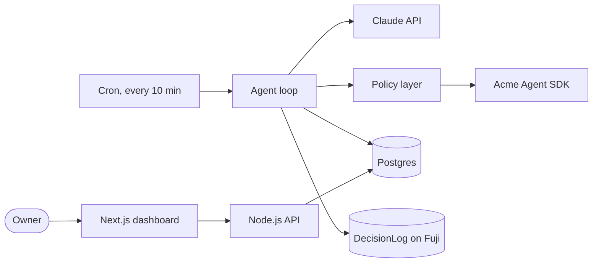

<!--
A FILLED-IN EXAMPLE of the template, for reference only.
The project, the team, the partner ("Acme Exchange") and every link and
address below are fictional. Copy the level of detail, not the content.
-->

# Tidewatch

**An autonomous agent that watches a small business's stablecoin treasury and moves idle funds into a safer yield position, with a hard cap a human sets once.**

<!-- In a real README, a hero screenshot goes here:  -->

---

## 1. At a glance

| | |
|---|---|
| **Event** | Example Hackathon, Ankara, 14 Mar 2027 |
| **Challenge / track** | Main challenge: build an autonomous agent with the partner's agent SDK |
| **Short description** | Small businesses that accept stablecoins leave them idle because rebalancing by hand is tedious and risky. Tidewatch is an agent that checks balances every 10 minutes, decides whether to move funds and executes within limits the owner sets once. Every decision is logged with its reasoning. |
| **Live demo** | https://tidewatch.example.app |
| **Demo video** | https://www.youtube.com/watch?v=example123 |
| **Pitch deck** | https://docs.google.com/presentation/d/example-tidewatch |
| **Tech stack** | TypeScript, Next.js, Node.js, Postgres, Claude API, Acme Agent SDK, Solidity on Avalanche Fuji |
| **Team** | Deniz Example, Ece Example, see [Team](#14-team) |
| **Status** | Working end to end on testnet; mainnet execution not enabled |

## 2. Event partner technologies

**Partner(s) of this event:** Acme Exchange (main), Avalanche (bonus)

**Did you use the partner's products?** Yes, both.

| Partner | Product | What it does in your project | How central is it? |
|---|---|---|---|
| Acme Exchange | Acme Agent SDK: market data | Reads prices and order book depth before every decision | Core |
| Acme Exchange | Acme Agent SDK: orders | Places and cancels the rebalancing orders | Core |
| Avalanche | C-Chain (Fuji testnet) | Stores a hash of every agent decision for audit | Supporting |

**Bonus tasks attempted:** Bonus 2, deploy on Avalanche: the `DecisionLog` contract in section 3, verified on the explorer.

## 3. Onchain deployments

| Network | Contract / purpose | Address | Explorer link | Verified source |
|---|---|---|---|---|
| Avalanche Fuji | `DecisionLog`: decision hashes | `0x1111111111111111111111111111111111111111` | https://testnet.snowtrace.io/address/0x1111111111111111111111111111111111111111 | Yes |

## 4. Built at the event

- **First commit of the project:** 14 Mar 2027, 10:04 TRT (UTC+3)
- **Pre-existing code you reused:** None
- **Third-party templates / starter kits:** `create-next-app` for the dashboard shell; OpenZeppelin `Ownable`
- **AI tools used while building:** Claude Code for most of the backend, Cursor for the frontend

---

## 5. Problem

A café chain in Ankara takes part of its payments in stablecoins. The balance sits idle in a hot wallet because nobody on the team has the time or confidence to move it, and every manual transfer is a chance to send the wrong amount. They need the money to work without anyone babysitting it, and they need to be able to see afterwards why each move was made.

## 6. Solution

1. The owner connects the treasury account once and sets two limits: the maximum share of funds the agent may move, and the minimum balance that must stay liquid.
2. Every 10 minutes the agent reads balances and market data through the Acme Agent SDK and asks the model whether a move is justified.
3. A deterministic policy layer checks the proposal against the limits. Only proposals that pass are executed; the rest are logged as rejected with a reason code.
4. The decision, its reasoning and the outcome appear on the dashboard, and a hash of each decision is written to Avalanche.

**What makes it different:** the model proposes but never authorises; limits are enforced in code, not in the prompt. Every decision is auditable after the fact, onchain.

## 7. Demo

<!-- In a real README, screenshots go here:  -->

**How to try it:** open the live demo and click "Use demo treasury". It runs against a funded testnet account, so you can press "Run one cycle now" and watch a decision go through. No login needed.

## 8. Architecture



**Components**

| Component | Responsibility | Tech |
|---|---|---|
| Dashboard | Limits setup, decision log, manual cycle | Next.js, Tailwind |
| Agent loop | Observe, propose, check, act | Node.js, Claude API |
| Policy layer | Hard limits, stale data and duplicate checks | TypeScript, no model calls |
| DecisionLog | Tamper-evident record of decisions | Solidity, Foundry |

**Key flows:** On each cycle the agent fetches balances and prices, sends a compact state summary to the model and receives a proposal in a fixed JSON schema. The policy layer rejects it if data is older than 60 s, if it exceeds the owner's limits or if an identical order was sent in the last cycle. An accepted proposal becomes an order through the SDK; the result and the reasoning are stored in Postgres and the hash goes onchain.

**Design decisions:** limits live in code because a prompt can be talked around; decisions are hashed onchain rather than stored there, to keep gas low; the loop is a cron job, not a long-running process, so a crash loses one cycle and nothing else.

## 9. Tech stack

| Layer | Technology | Why this choice |
|---|---|---|
| Frontend | Next.js, Tailwind | Fastest path to a usable dashboard |
| Backend | Node.js, TypeScript | Same language as the partner SDK |
| AI / ML | Claude API, structured JSON output | Reliable schema adherence for proposals |
| Data | Postgres | Decision history with simple queries |
| Blockchain | Avalanche Fuji, Solidity, Foundry | Bonus task; cheap and fast testnet |
| Infra / hosting | Railway | One-click Postgres and cron |

## 10. AI and agents

- **Model(s) and provider:** Claude, through the Anthropic API
- **What the AI decides on its own:** whether to move funds, in which direction and how much, within the owner's limits. Changing the limits always needs the owner.
- **Tools / actions available to the agent:** `get_balances`, `get_market`, `propose_order`
- **Agent loop:** every 10 minutes: observe, propose, policy check, execute or reject, record.
- **Guardrails:** hard caps in the policy layer, a 60 s staleness limit, duplicate-order detection, and a kill switch on the dashboard.

## 11. Getting started

**Prerequisites:** Node.js 20+, Postgres 15+, Foundry, and your own Anthropic and Acme testnet accounts.

```bash
git clone https://github.com/example-team/tidewatch
cd tidewatch
cp .env.example .env   # then add your own keys
npm install
npm run dev
```

**Environment variables**

| Variable | Required | What it is for |
|---|---|---|
| `ANTHROPIC_API_KEY` | Yes | Model access for the agent |
| `ACME_API_KEY`, `ACME_API_SECRET` | Yes | Partner SDK credentials, testnet |
| `DATABASE_URL` | Yes | Postgres connection string |
| `FUJI_RPC_URL`, `DEPLOYER_KEY` | Only to deploy | Contract deployment |

**Tests:** `npm test` runs the policy layer tests; `forge test` in `contracts/`.

## 12. Project structure

```text
.
├── app/          Next.js dashboard
├── agent/        agent loop, tools and policy layer
├── contracts/    DecisionLog contract and deploy script
└── docs/         screenshots and run logs
```

## 13. What works, what does not

| Feature | Status | Notes |
|---|---|---|
| Agent loop on testnet | ✅ Working | Ran unattended for 6 hours on the day |
| Policy layer | ✅ Working | 14 unit tests |
| Onchain decision log | ✅ Working | Fuji only |
| Multi-account support | 🟡 Partial | UI exists, backend handles one account |
| Mainnet execution | ❌ Not started | Deliberately disabled |

**Known limitations:** one treasury account per deployment; the model sometimes proposes amounts below the exchange minimum, which the policy layer rejects.

**Next steps:** multi-account support, an approval flow by phone for moves above a threshold, and a pilot with the café chain.

## 14. Team

| Name | Role in this project | GitHub | Contact (X / LinkedIn) |
|---|---|---|---|
| Deniz Example | Agent loop, policy layer | @deniz-example | x.com/deniz_example |
| Ece Example | Dashboard, contract | @ece-example | linkedin.com/in/ece-example |

## 15. Anything else

We interviewed the café's accountant before writing any code; the "minimum liquid balance" limit came from that conversation. The full notes are in `docs/interview.md`.

## 16. License

MIT, see [LICENSE](LICENSE).

---

<sub>Built at a Team1 Türkiye hackathon. Started from the <a href="https://github.com/Team1-Turkiye/hackathon-template">Team1 Türkiye hackathon template</a>.</sub>
